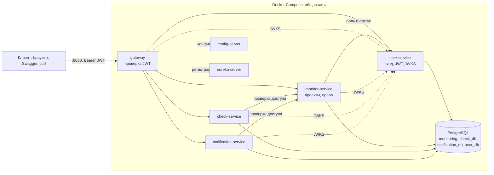
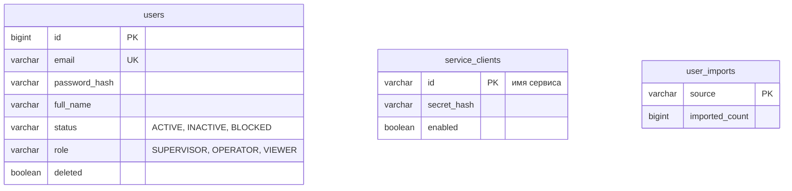
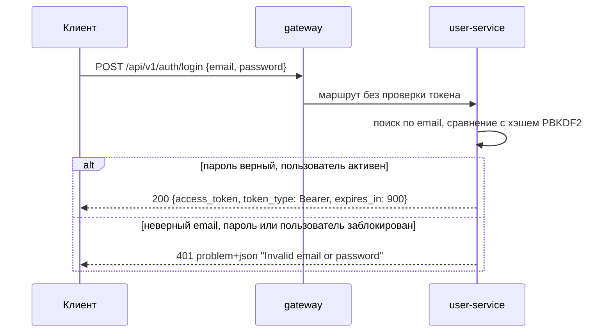
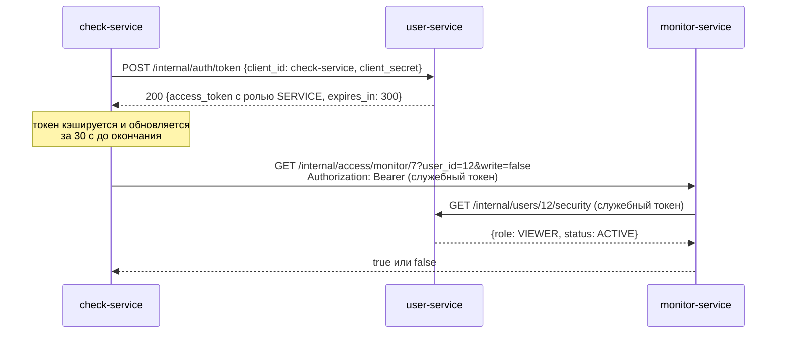

# Лабораторная работа №3. Сервис мониторинга веб-сайтов: авторизация и ролевая модель

**Репозиторий:** https://github.com/awesoma31/service-monitoring
**Версия:** тег `v3.0.0-lab3`

## 1. Задание

Добавить в микросервисную систему из лабораторной работы №2 авторизацию:

- авторизация на Spring Security с JWT-токеном в заголовке `Authorization`;
- ролевая модель;
- методы, логика которых меняется в зависимости от текущего пользователя;
- пароль не возвращается ни в одном ответе, где участвует модель пользователя;
- все пароли хранятся в хэшированном виде;
- пользователей могут создавать только супервайзеры.

Требования лабораторных работ №1 и №2 сохраняются. Соответствие требований и реализации —
в разделе 13.

## 2. Предметная область

К понятиям из лабораторной работы №2 добавились роли и служебные клиенты, а пользователи
переехали в отдельный сервис.

| Понятие | Описание | Сервис |
|---|---|---|
| Пользователь | учётная запись: email, имя, хэш пароля, роль, статус | user-service |
| Роль | глобальные права пользователя: `SUPERVISOR`, `OPERATOR` или `VIEWER` | user-service |
| Служебный клиент | сервис системы, который получает токен по своему секрету для внутренних вызовов | user-service |
| Проект | рабочее пространство с владельцем (`owner_id`), участниками и мониторами | monitor-service |
| Участник | пользователь, добавленный в проект; даёт доступ к ресурсам проекта | monitor-service |

Права пользователя складываются из двух частей: глобальной роли и отношения к проекту
(владелец, участник или посторонний). Роль определяет, что пользователь может делать в
принципе, отношение к проекту — над какими данными.

| Роль | Назначение |
|---|---|
| `SUPERVISOR` | администратор: видит и меняет всё, единственный, кто управляет пользователями |
| `OPERATOR` | создаёт свои проекты и работает с ресурсами проектов, в которых участвует |
| `VIEWER` | только читает ресурсы проектов, в которых участвует; роль по умолчанию |

## 3. Архитектура

### 3.1. Развёртывание

К восьми контейнерам лабораторной работы №2 добавился `user-service` со своей базой
`user_db`. Токен проверяют и gateway, и каждый сервис; открытый ключ для проверки подписи
они получают из user-service.



| Контейнер | Назначение | Доступ с хоста |
|---|---|---|
| `postgres` | PostgreSQL 17, базы всех сервисов | `:5432` (для отладки) |
| `postgres-init` | создание баз `check_db`, `notification_db`, `user_db`, завершается после выполнения | — |
| `config-server`, `eureka-server` | конфигурация и реестр сервисов | `:8761` (панель Eureka) |
| `user-service` | пользователи, вход, выдача JWT, служебные клиенты | — |
| `monitor-service`, `check-service`, `notification-service` | бизнес-сервисы | — |
| `gateway` | точка входа в API, проверка JWT, общий Swagger UI | `:8080` |

Ключ подписи JWT хранится в томе `user-signing-keys`, который подключён только к
user-service. monitor-service зависит от user-service по условию `service_started`, а не
`service_healthy`: при обновлении стека с базой лабораторной работы №2 user-service
становится готовым только после переноса пользователей, а пароли для переноса хэширует
миграция monitor-service (раздел 4.3).

### 3.2. Модули

| Модуль | Что добавлено |
|---|---|
| `user-service` (новый) | Spring MVC + JPA; вход, выдача и подпись JWT, JWKS, CRUD пользователей, служебные клиенты, перенос пользователей из monitor-service, создание первого супервайзера |
| `security-common` (новый) | общий код безопасности: проверка JWT, реактивная цепочка фильтров, хэширование паролей, получение служебного токена, проверка доступа через monitor-service |
| `monitor-service` | права на проекты и их ресурсы (`AccessPolicy`, `@PreAuthorize`), внутренний метод проверки доступа, данные пользователей через Feign к user-service |
| `check-service`, `notification-service` | Resource Server на WebFlux, проверка доступа к ресурсу перед ответом |
| `gateway` | Resource Server на WebFlux, маршруты user-service и JWKS |

`security-common` подключается к сервисам как обычная Gradle-зависимость и импортом
конфигураций (`ReactiveSecurityConfiguration`, `ServiceTokenConfiguration`,
`RemoteAccessConfiguration`), поэтому правила проверки токена одинаковы во всех сервисах.

### 3.3. Технологии

| Задача | Технология |
|---|---|
| Аутентификация и авторизация | Spring Security, OAuth2 Resource Server (JWT) |
| Подпись и проверка JWT | Nimbus JOSE + JWT, алгоритм RS256, ключ RSA 2048 бит, JWKS |
| Хэширование паролей и секретов | `Pbkdf2PasswordEncoder` (PBKDF2-HMAC-SHA256) через `DelegatingPasswordEncoder` |
| Проверка прав в методах | `@EnableMethodSecurity`, `@PreAuthorize` с бином `@access` |
| Межсервисные вызовы | Feign с перехватчиком, добавляющим служебный токен; Circuit Breaker из лабораторной работы №2 |

## 4. Модель данных

### 4.1. База user-service



| Таблица | Назначение |
|---|---|
| `users` | учётные записи; пароль хранится только хэшем; удаление мягкое (`deleted`), чтобы id остался у владельцев и участников проектов |
| `service_clients` | служебные клиенты `monitor-service`, `check-service`, `notification-service` с хэшами секретов |
| `user_imports` | отметка о выполненном переносе пользователей из monitor-service, защищает от повторного импорта |

Ограничения целостности: `role` и `status` — только из перечисленных значений (CHECK),
`email` уникален и имеет форму адреса, `full_name` не пустой.

### 4.2. Изменения в базе monitor-service

Пользователи больше не хранятся в monitor-service. Проект ссылается на владельца по
`owner_id`, участник — по `user_id`, без внешних ключей на другой сервис, как и остальные
межсервисные ссылки. Имена и email участников monitor-service получает одним пакетным
запросом к user-service на страницу (до 50 id).

### 4.3. Миграции и перенос пользователей

| Миграция | Сервис | Что делает |
|---|---|---|
| `021-security` | monitor-service | добавляет колонку `role` (по умолчанию `VIEWER`), хэширует все открытые пароли Java-миграцией `HashPasswordsMigration` и переименовывает колонку в `password_hash` |
| `022-extract-users` | monitor-service | удаляет внешние ключи на `users` и переименовывает таблицу в `legacy_users` (архив для сверки) |
| `user-001-schema` | user-service | создаёт `users`, `service_clients`, `user_imports` |

При старте user-service переносит пользователей из базы monitor-service
(`LegacyUserImporter`): id, email, имена, статусы, роли и готовые хэши, без повторного
хэширования. Перенос выполняется в одной транзакции под advisory-блокировкой: конфликт id
или email откатывает его целиком. Последовательность id сдвигается за последний
перенесённый id. Если monitor-service ещё не применил `021` (в таблице нет `password_hash`),
перенос ждёт, проверяя каждые 2 с, до `USER_MIGRATION_WAIT_TIMEOUT` (по умолчанию 5 минут).
Хэширование необратимо: откат `021` возвращает имя колонки, но не открытые пароли.

## 5. Аутентификация

### 5.1. Вход



Если пользователь с таким email не найден, пароль всё равно сравнивается с заранее
вычисленным фиктивным хэшем, поэтому время ответа не выдаёт, существует ли email.

### 5.2. Токен

| Поле | Значение |
|---|---|
| `iss` | `service-monitoring` |
| `aud` | `service-monitoring-api` |
| `sub` | id пользователя (для служебного токена — имя сервиса) |
| `roles` | роль пользователя, например `["OPERATOR"]`, или `["SERVICE"]` |
| `iat`, `exp` | время выдачи и окончания: 15 минут для пользователя (`JWT_TTL`), 5 минут для сервиса (`SERVICE_JWT_TTL`) |

Токен подписывается RS256. Закрытый ключ создаёт и хранит только user-service, остальным
он не передаётся. Открытый ключ отдаётся по `GET /.well-known/jwks.json`, и только он:
закрытые параметры ключа в ответ не попадают. С HS256 общий секрет пришлось бы раздать
всем сервисам, и любой из них мог бы выпустить токен.

При проверке токена сверяются подпись, `iss`, `aud`, `exp` и `nbf`. Пароль и его хэш в
токен не входят. Refresh-токены не используются: по истечении срока нужен новый вход.

### 5.3. Проверка токена в сервисах

Каждый сервис — OAuth2 Resource Server и проверяет токен сам, даже если запрос пришёл
через gateway. Сессий нет (`STATELESS`), CSRF, Basic Auth и форма входа отключены.

| Где | Откуда берётся роль |
|---|---|
| gateway, check-service, notification-service | из токена (`roles` → `ROLE_*`) |
| user-service, monitor-service | из базы user-service при каждом запросе (`DatabaseJwtAuthenticationConverter`) |

Поэтому блокировка, удаление или понижение роли действуют в monitor-service и
user-service сразу, даже для ещё не истёкшего токена. Права на конкретный проект
check-service и notification-service тоже проверяют по актуальным данным, через
monitor-service (раздел 7).

## 6. Ролевая модель и права

### 6.1. Права по ролям

| Действие | SUPERVISOR | OPERATOR | VIEWER |
|---|---|---|---|
| Создать пользователя, изменить роль или статус, удалить | да | нет | нет |
| Список пользователей | да | нет | нет |
| Свой профиль (`/auth/me`, `/users/{свой id}`) | да | да | да |
| Список проектов | все проекты | свои и с участием | свои и с участием |
| Читать проект, мониторы, инциденты, историю, каналы, уведомления | все | при доступе к проекту | при доступе к проекту |
| Создать проект | для любого владельца | только на себя | нет |
| Менять мониторы и каналы, закрывать инциденты | все | при доступе к проекту | нет |
| Менять и удалять проект, управлять участниками и уведомлениями владельца | все | только владелец | нет |
| Создавать теги | да | да | нет |
| Удалять теги, смотреть состояние сервисов | да | нет | нет |

Доступ к проекту есть у его владельца и участников. Участие в проекте не даёт
просмотрщику права на запись, а роль оператора сама по себе не открывает чужие проекты.

### 6.2. Где проверяются права

Права проверяются в два слоя.

1. **По адресу запроса** — `SecurityFilterChain` в каждом сервисе и в gateway:
   - `/api/v1/**` на чтение (`GET`) — любая пользовательская роль;
   - `/api/v1/**` на запись — `SUPERVISOR` или `OPERATOR`;
   - `/api/v1/users/**`, `/api/v1/services/**`, `/actuator/**` — только `SUPERVISOR`;
   - `/internal/**` — только `SERVICE`;
   - вход, JWKS, Swagger и healthcheck — без токена;
   - всё остальное запрещено (`denyAll`).
2. **По конкретному ресурсу** — `@PreAuthorize` на методах контроллеров monitor-service и
   user-service. Выражения обращаются к бину `@access` (`AccessPolicy`):

```java
@PreAuthorize("@access.project(#projectId, true)")   // запись в проект
public ResponseEntity<MonitorResponse> create(@PathVariable Long projectId, ...)

@PreAuthorize("@access.owner(#id)")                  // только владелец или супервайзер
public ResponseEntity<Void> delete(@PathVariable Long id)

@PreAuthorize("@access.canCreateProject(#request.ownerId())")
public ResponseEntity<ProjectResponse> create(@RequestBody ProjectCreateRequest request)
```

`AccessPolicy.allowed` получает роль и статус пользователя из user-service; неактивному
пользователю отказывает, супервайзеру разрешает всё, при записи требует `OPERATOR`, затем
находит проект ресурса (для монитора и инцидента — по их `project_id`) и проверяет, что
пользователь его владелец или участник.

### 6.3. Логика, зависящая от пользователя

| Метод | Как меняется результат |
|---|---|
| `GET /api/v1/projects` | супервайзер получает все проекты (`findAll`), остальные — только свои и с участием (`findAccessible`); пагинация и `total_elements` считаются по доступным |
| `POST /api/v1/projects` | супервайзер создаёт проект для любого владельца, оператор — только с собственным `owner_id`, иначе 403 |
| `GET /api/v1/users/{id}` | супервайзер видит любого пользователя, остальные — только себя |
| `PUT /api/v1/projects/{id}` и управление участниками | доступно владельцу проекта и супервайзеру, оператору-участнику — нет |
| Чтение и запись ресурсов проекта | один и тот же `GET /api/v1/projects/{id}` у просмотрщика даёт 403, пока его не добавят в участники, и 200 после этого |

## 7. Межсервисная авторизация

Сервисы вызывают друг друга без пользователя: планировщик check-service, события
monitor-service. Для этого у каждого сервиса есть служебный клиент в user-service с
отдельным секретом.



- Служебный токен всегда получает только роль `SERVICE`, запросить другую роль нельзя.
  Пользовательский токен роль `SERVICE` получить не может, а служебный не открывает
  пользовательский API.
- Секреты клиентов хранятся хэшем в `service_clients`; при старте user-service берёт их из
  переменных окружения, так что секрет меняется без изменения кода.
- Feign-перехватчик добавляет служебный токен ко всем внутренним вызовам. Сам токен
  запрашивается отдельным HTTP-клиентом, чтобы не попасть в собственный перехватчик Feign.
- Методы `/internal/**` gateway не маршрутизирует, а сами сервисы принимают их только со
  служебным токеном.

Чтобы показать пользователю историю проверок или каналы, check-service и
notification-service берут id пользователя из проверенного JWT и спрашивают
monitor-service через `GET /internal/access/{resource}/{id}` (`RemoteAccess`). Если
monitor-service недоступен, доступ не выдаётся: ответ 503, а не 200.

## 8. Хранение паролей

- Пароли и секреты служебных клиентов хэшируются `Pbkdf2PasswordEncoder` с параметрами
  Spring Security 5.8 и случайной солью. Хэш хранит идентификатор алгоритма
  (`{pbkdf2@SpringSecurity_v5_8}...`), поэтому алгоритм можно сменить, не переделывая
  базу. PBKDF2 выбран вместо BCrypt, потому что BCrypt учитывает только первые 72 байта, а
  API допускает пароли до 255 символов.
- Ответы с моделью пользователя (`UserResponse`) содержат только `id`, `email`,
  `full_name`, `status` и `role`. Поле хэша в сущности дополнительно помечено
  `@JsonIgnore`, а пароли во входных моделях — как только для записи (`WRITE_ONLY`).
- Старые открытые пароли лабораторных работ №1–2 хэширует миграция `021`, после чего ими
  можно входить, как раньше.

**Первый супервайзер.** Пользователей создаёт только супервайзер, поэтому первый создаётся
при старте user-service из `SUPERVISOR_EMAIL` и `SUPERVISOR_PASSWORD`, и только если
супервайзеров ещё нет. Это механизм подготовки пустой системы, а не публичная регистрация;
повторный запуск не меняет пароли и роли существующих аккаунтов.

## 9. Ошибки авторизации

| Код | Когда |
|---|---|
| 401 | нет токена, токен неверный, просрочен или с чужой подписью; неверный email или пароль; пользователь заблокирован или удалён |
| 403 | токен верный, но роли или доступа к ресурсу недостаточно |
| 503 | недоступен сервис, который проверяет пользователя или права (user-service или monitor-service) |

Все ответы — `application/problem+json` в формате ошибок проекта, без паролей и деталей
проверки; ответ 401 содержит заголовок `WWW-Authenticate: Bearer`:

```json
{"type": "about:blank", "title": "Unauthorized", "status": 401,
 "detail": "A valid Bearer token is required"}
```

## 10. REST API

Новые и изменённые методы. Остальной API лабораторной работы №2 сохранился и теперь
требует токен.

| Метод | Сервис | Доступ | Назначение |
|---|---|---|---|
| `POST /api/v1/auth/login` | user-service | без токена | вход, выдача JWT |
| `GET /api/v1/auth/me` | user-service | любая роль | текущий пользователь с ролью |
| `POST /api/v1/auth/register` | user-service | SUPERVISOR | создание пользователя, то же, что `POST /users` |
| `GET /api/v1/users` | user-service | SUPERVISOR | список пользователей, до 50 на страницу |
| `POST /api/v1/users` | user-service | SUPERVISOR | создание пользователя; роль по умолчанию `VIEWER`; 201 и `Location` |
| `GET /api/v1/users/{id}` | user-service | SUPERVISOR или сам пользователь | пользователь без пароля |
| `PUT /api/v1/users/{id}` | user-service | SUPERVISOR | имя и статус (`ACTIVE`, `INACTIVE`, `BLOCKED`) |
| `PUT /api/v1/users/{id}/role` | user-service | SUPERVISOR | смена роли |
| `DELETE /api/v1/users/{id}` | user-service | SUPERVISOR | мягкое удаление |
| `GET /.well-known/jwks.json` | user-service | без токена | открытый ключ подписи JWT |
| `GET /api/v1/services/{service}/health` | monitor-service | SUPERVISOR | состояние check-service и notification-service |
| `POST /internal/auth/token` | user-service | секрет клиента | служебный токен |
| `GET /internal/users/{id}/security`, `POST /internal/users/batch` | user-service | SERVICE | роль и статус, профили участников |
| `GET /internal/access/{resource}/{id}` | monitor-service | SERVICE | есть ли у пользователя доступ к проекту, монитору или инциденту |

В общем Swagger UI на gateway появился документ `user-service`, у всех документов есть
схема безопасности `bearerAuth`: токен вставляется кнопкой Authorize.

## 11. Конфигурация и запуск

Новые переменные окружения (`docker-compose.yml`, `.env`, образец — `.env.example`):

| Переменная | Сервисы | Назначение |
|---|---|---|
| `JWT_TTL`, `SERVICE_JWT_TTL` | все | срок пользовательского и служебного токена (по умолчанию `PT15M`, `PT5M`) |
| `JWT_JWK_SET_URI` | все, кроме user-service | адрес JWKS для проверки подписи |
| `SERVICE_TOKEN_URI`, `SERVICE_CLIENT_SECRET` | monitor-, check-, notification-service | получение служебного токена |
| `MONITOR_SERVICE_CLIENT_SECRET`, `CHECK_SERVICE_CLIENT_SECRET`, `NOTIFICATION_SERVICE_CLIENT_SECRET` | user-service и соответствующий сервис | секреты служебных клиентов, не короче 32 символов |
| `SUPERVISOR_EMAIL`, `SUPERVISOR_PASSWORD` | user-service | первый супервайзер |
| `USER_MIGRATION_SOURCE_URL`, `USER_MIGRATION_WAIT_TIMEOUT` | user-service | база monitor-service для переноса пользователей; сколько ждать её миграции |
| `JWT_KEY_FILE` | user-service | файл ключа подписи в томе `user-signing-keys` |

Запуск и проверка:

```bash
cp .env.example .env                  # задать SUPERVISOR_PASSWORD и секреты клиентов
docker compose up -d --build --wait   # 9 контейнеров; стек лабы 2 обновляется этой же командой
set -a; . ./.env; set +a
./scripts/auth-demo.sh                # вход, роли и доступ к проектам через gateway
./scripts/demo.sh                     # сквозной сценарий лабы 2 под супервайзером
./scripts/circuit-breaker-demo.sh     # Circuit Breaker под супервайзером
./gradlew check                       # тесты и контроль покрытия всех модулей
```

Скрипт `scripts/auth-demo.sh` проверяет через gateway 18 ответов:
- вход и 401 без токена;
- отсутствие пароля в ответах;
- создание пользователей только супервайзером;
- оператор создаёт проект на себя, просмотрщик получает 403 до добавления в участники и
  только читает после него;
- права на историю проверок и каналы в check-service и notification-service.

`demo.sh` и `circuit-breaker-demo.sh` входят под супервайзером по `SUPERVISOR_PASSWORD`
или используют переданный `TOKEN`.

## 12. Тестирование

| Модуль | Тестов | Покрытие строк | Что проверяется |
|---|---|---|---|
| user-service | 33 | 90,7% | вход и выдача RS256-токена, проверка по одному JWKS, создание пользователей только супервайзером, хранение только хэшей, служебные токены, блокировка и смена роли для уже выданного токена, мягкое удаление, сохранение ключа при перезапуске, первый супервайзер, перенос пользователей (откат при конфликте, ожидание миграции `021`), Swagger со схемой Bearer |
| monitor-service | 119 | 92,6% | права по ролям, владению и участию, блокировка и смена роли через user-service, служебная идентичность и внутренний метод доступа, 503 при недоступности проверки, миграция паролей на PostgreSQL, остальные правила лабораторных работ №1–2 |
| security-common | 9 | 87,7% | подпись, issuer, audience и срок JWT, проверка подписи по HTTP JWKS, получение и кэш служебного токена, отказ в доступе при сбое проверки |
| check-service | 28 | 89,9% | доступ к истории проверок, служебный токен для внутренних методов, Circuit Breaker |
| notification-service | 30 | 89,8% | отказ в доступе к каналам без прав на проект, служебный токен для внутренних методов, доставка уведомлений |
| gateway | 7 | 90,9% | маршруты, в том числе user-service и JWKS, fallback, общий Swagger |
| config-server | 4 | — | выдача конфигурации каждому сервису |
| eureka-server | 1 | — | работа реестра |

Всего 231 тест. Для каждого модуля с логикой задача `check` завершается ошибкой при
покрытии строк ниже 70% (JaCoCo). В тестах токены подписываются тестовым ключом
(`TestKeys`, `TestJwtConfiguration` в `testFixtures` модуля security-common), а user-service
для monitor-service заменяется заглушкой Feign-клиента, поэтому права проверяются без
запуска остальных сервисов.

## 13. Соответствие требованиям

| Требование | Реализация |
|---|---|
| Авторизация | Spring Security Resource Server во всех сервисах и gateway; раздел 5.3 |
| Spring Security + JWT в заголовке `Authorization` | вход в user-service, токен RS256, заголовок `Authorization: Bearer`; разделы 5.1, 5.2 |
| Ролевая модель | роли `SUPERVISOR`, `OPERATOR`, `VIEWER` и участие в проектах; раздел 6.1 |
| Методы с логикой, зависящей от текущего пользователя | список проектов, создание проекта, профиль пользователя, доступ к ресурсам проекта; раздел 6.3 |
| Пароль не возвращается в ответах | `UserResponse` без пароля и хэша, `@JsonIgnore`, `WRITE_ONLY`; раздел 8 |
| Пароли хранятся хэшированными | PBKDF2, миграция `021` для старых паролей; разделы 4.3, 8 |
| Пользователей создают только супервайзеры | `POST /api/v1/users` и `/auth/register` только для `SUPERVISOR`, первый супервайзер из окружения; разделы 6.1, 8 |
| Требования лабораторных работ №1–2 | сохранены; межсервисные вызовы дополнительно защищены служебными токенами; раздел 7 |
| Запуск через Docker Compose | раздел 11 |
| Тесты, покрытие не ниже 70% | раздел 12 |
| Общий Swagger | документ user-service и схема `bearerAuth` во всех документах; раздел 10 |
